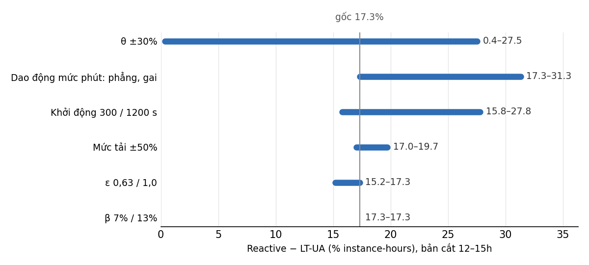

# SENSITIVITY – Pha 3

Số T48 (main a5d1967, 25/11/2026); số v2.1 ghi trong ngoặc ở phần chữ, bảng v2.1 đầy đủ trong git history của file này.

**Số T48** (main `a5d1967`; kết quả ở `E:/SageServe_results_t48m/sens`, `.../sens2`, chạy bằng `runner.py --config experiments/configs/sens.yaml` và `sens2.yaml`; xong 25/11/2026, 31 bài, 0 lỗi). Số v2 cũ có trong git history của file này.

Bản cắt 12–15h của `composed_day_3regions_v2`, A100, θ `data/theta_tps_v2.csv`, bỏ giờ đầu, mỗi lần đổi một yếu tố. Số đầy đủ: `SENSITIVITY.csv`.
Chạy: `python experiments/make_sens_traces.py` (sinh `traces/sens_*.csv`; sha256 sens_flat 9d90fa80…, sens_spike 68846dae…, sens_rate50 7e1316bc…, sens_rate150 13f5f69c…, sens_burst_in d2d3372c…, sens_burst_out 61afbf20…), rồi `PY=<python> bash experiments/run_sens.sh sens E:/SageServe_results_t48m/sens` (21 bài, ~3 giờ mô phỏng mỗi bài; biến `SAGE_SPIN_UP`, `SAGE_WAIT`, `SAGE_BETA` đặt trong script). Phân tích (chạy ở gốc repo): `python experiments/analyze_sensitivity.py E:/SageServe_results_t48m/sens --out SENSITIVITY.csv`; biểu đồ: `python experiments/plot_sensitivity.py SENSITIVITY.csv SENSITIVITY.png`.

## Khoảng cách Reactive − LT-UA

| Yếu tố | Mức | Reactive IH | LT-UA IH | Khoảng cách tổng | Llama-2 | Bloom | Lãng phí R → U (instance-hours) |
|---|---|---:|---:|---:|---:|---:|---:|
| Gốc | | 196,00 | 167,50 | **14,5%** | 15,9% | 21,2% | 3,32 → 2,56 (−23%) |
| d) θ | −30% | 196,00 | 192,25 | **1,9%** | 2,1% | +5,6% | 3,32 → 3,33 (+0%) |
| d) θ | +30% | 196,00 | 149,75 | **23,6%** | 16,9% | 35,3% | 3,32 → 1,37 (−59%) |
| a) Dao động phút | phẳng | 202,25 | 164,50 | 18,7% | 11,8% | 29,6% | 2,89 → 2,16 (−25%) |
| a) Dao động phút | gai 1,77× | 213,50 | 166,00 | 22,2% | 16,0% | 33,6% | 3,98 → 2,34 (−41%) |
| b) Khởi động | 300 s | 198,50 | 170,50 | 14,1% | 14,3% | 21,0% | 1,57 → 1,57 (+0%) |
| b) Khởi động | 1200 s | 195,25 | 161,75 | 17,2% | 15,0% | 25,6% | 5,90 → 3,87 (−34%) |
| c) Cooldown Reactive | chờ instance sẵn sàng | 191,00 | 167,50 | 12,3% | – | – | 2,34 → 2,56 |
| d) ε | 0,63 | 196,00 | 172,00 | 12,2% | 14,4% | 18,1% | 3,32 → 1,24 (−63%) |
| d) ε | 1,0 | 196,00 | 168,75 | 13,9% | 11,8% | 21,6% | 3,32 → 3,26 (−2%) |
| d) β | 7% / 13% | 196,00 | 167,50 | 14,5% | 15,9% | 21,2% | không đổi |
| e) Mức tải | ×0,5 | 121,25 | 114,75 | 5,4% | 23,4% | 25,6% | 1,04 → 1,80 (+73%) |
| e) Mức tải | ×1,5 | 273,00 | 227,00 | 16,8% | 9,2% | 24,2% | 4,45 → 4,27 (−4%) |

Dòng c) chỉ chạy Reactive. LT-UA lấy từ dòng gốc vì LT-UA không dùng cooldown Reactive.

## Kết luận

- **θ vẫn chi phối:** khoảng cách dao động 21,7 điểm, gần gấp 2 yếu tố đứng sau (v2: 21,3 điểm, gần gấp 3 lần). Yếu tố đứng thứ hai nay là mức tải (11,5 điểm; ×0,5 cho 5,4%) (v2.1: dao động phút 14,0 và khởi động 12,0 điểm). Hai yếu tố tiếp theo:
  - Dao động phút: 7,7 điểm. Không đơn điệu: cả dạng phẳng lẫn dạng gai đều cho khoảng cách lớn hơn gốc.
  - Thời gian khởi động: 3,1 điểm (v2: dưới 3 điểm).

  Cooldown 2,2 điểm; mức tải 11,5; ε 2,3. β không đổi kết quả vì phần cộng thêm rất nhỏ so với đỉnh dự báo (ví dụ ±10 TPM trên 122.000 TPM).
- **Đổi so với v2:** IH gốc 191,50 → 196,00, LT-UA gần như không đổi (167,00 → 167,50).
- **Đổi so với v2.1 (T48):** Reactive gốc 200,75 → 196,00 IH, LT-UA 166,00 → 167,50; khoảng cách gốc 17,3% → 14,5%, khởi động 1200 s 27,8% → 17,2%, phút phẳng / gai 31,3% → 18,7% / 22,2%, mức tải ×0,5 19,7% → 5,4%. Ở các mức làm Reactive tăng giờ máy mạnh nhất (khởi động dài, phút phẳng/gai), Reactive T48 tăng ít hơn v2.1, khả dĩ do luật deployment 2–3 instance tính cả instance đang chờ và cooldown theo request (D39). Khoảng cách ở tải ×0,5 giảm mạnh, khả dĩ do sàn 2 instance mỗi endpoint trong mục tiêu ILP (D39) giữ LT-UA ở sàn khi tải thấp. Hai giải thích này suy theo bậc thang `lt` (1b → 2 đổi cả bốn chiến lược), chưa đo riêng trên bản cắt.
- **Theo luật Pha 3 (D11):**
  - (a) vẫn không chi phối và trace đạt T6, nên **không sửa trace**.
  - θ chi phối nên đã kiểm lại Pha 2: `benchmark_theta.py` đúng định nghĩa §2.1, nhưng bài báo không cho mức latency mục tiêu, tải đo hay bảng θ. **Loại C:** giữ θ đo được, không chỉnh để tăng tiết kiệm.

  Bằng chứng ghi trong D11 là số v2 (“các yếu tố khác dưới 5 điểm”). Ở T48, thời gian khởi động 3,1 điểm và dao động phút 7,7 điểm. Quyết định không đổi.
- **Giới hạn:** bản cắt 12–15h không có giờ 5–9, là các giờ khó nhất, nên SLA gần như không đổi ở mọi mức θ. Không suy từ đây rằng θ +30% an toàn: θ đo theo tỉ lệ cả ngày (Bloom 528, Llama-2 1315, cao hơn v2 37% và 35%) từng cho TTFT P95 Llama-2 7073 s trên trace v1.

## Lệch còn lại

**Burst.** Kết quả ở `E:/SageServe_results_t48m/sens2`. Chạy: `PY=<python> bash experiments/run_sens.sh sens2 E:/SageServe_results_t48m/sens2` (10 bài, gồm `SAGE_NO_DOWN=1` cho LT-UA tắt luật giảm). Phân tích: `python experiments/analyze_burst_cut.py E:/SageServe_results_t48m/sens2`. Một burst ×8 dài 10 phút:

| Vị trí | Chiến lược | IH | Vi phạm Llama-2 | Vi phạm Bloom | Bộ nhớ Llama-2 hồi về < 70% |
|---|---|---:|---:|---:|---:|
| Trong 20 phút cuối giờ | Reactive | 288,5 | 34,97% | 46,57% | 956 s |
| | LT-U | 162,25 | 59,83% | 59,22% | 4800 s |
| | **LT-UA** | 311,25 | **36,31%** | **52,09%** | **1044 s** |
| Ngoài 20 phút cuối giờ | Reactive | 282,75 | 31,19% | 43,12% | 936 s |
| | LT-U | 163,25 | 63,16% | 69,03% | 6600 s |
| | LT-UA | 166,5 | 67,31% | 64,13% | 6600 s |

- LT-UA hơn LT-U đúng như §7.2.7 khi burst rơi vào cửa sổ. Khi burst nằm ngoài, LT-UA không còn trùng LT-U (v2, v2.1: trùng) mà vi phạm Llama-2 nhiều hơn (bảng); khả dĩ do D38 (LT-UA tăng thêm khi tải vượt xa dự báo, cả ngoài cửa sổ 20 phút cuối giờ); suy theo bậc thang `lt`, chưa đo riêng. Bài báo không cho thời điểm burst: **loại C**.
- Vi phạm cao hơn Reactive là hệ quả của thiết kế: LT-I, LT-U không vượt mục tiêu ILP (§7.2.7).
- Tắt luật ≤ 0,5× nay đổi kết quả chút ít (LT-UA tắt luật giảm: 35,74% trong cửa sổ, 66,29% ngoài cửa sổ; v2.1: không đổi).

**A100 và H100.** Bản cắt: A100 14,5%, H100 14,2% (Llama-2 10,8%, Bloom 24,5%), A100 nay hơn H100 0,4 điểm (v2.1: A100 17,3%, H100 18,6%, A100 không hơn). Tăng thời gian khởi động A100 lên 1200 s cho 17,2%, tức khoảng cách **tăng** so với gốc (v2: 11,2%, không tăng). Điều này hợp với lý giải của Phụ lục A (“longer model loading times”): lãng phí khi tăng máy của Reactive lên 5,90 instance-hours (gốc 3,32). Bài báo không cho thời gian tải A100: **loại C**.

**Cuối tuần:** cần bài `week` của Pha 4, sẽ ghi vào `RESULTS.md`.
