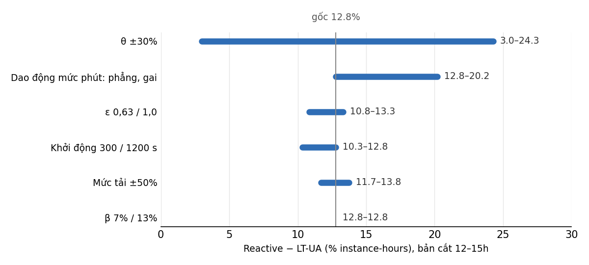

# SENSITIVITY – Pha 3

Bản cắt 12–15h của `composed_day_3regions_v2`, A100, θ `data/theta_tps_v2.csv`, bỏ giờ đầu, mỗi lần đổi một yếu tố. Số đầy đủ: `SENSITIVITY.csv`.
Chạy: `python experiments/make_sens_traces.py` (sinh `traces/sens_*.csv`; sha256 sens_flat 9d90fa80…, sens_spike 68846dae…, sens_rate50 7e1316bc…, sens_rate150 13f5f69c…, sens_burst_in d2d3372c…, sens_burst_out 61afbf20…), rồi `PY=<python> bash experiments/run_sens.sh sens` (21 bài, ~3 giờ mô phỏng mỗi bài; biến `SAGE_SPIN_UP`, `SAGE_WAIT`, `SAGE_BETA` đặt trong script). Phân tích: `python experiments/analyze_sensitivity.py D:/SageServe_results/v2/sens --out SENSITIVITY.csv`; biểu đồ: `python experiments/plot_sensitivity.py SENSITIVITY.csv SENSITIVITY.png`.

## Khoảng cách Reactive − LT-UA

| Yếu tố | Mức | Reactive IH | LT-UA IH | Khoảng cách tổng | Llama-2 | Bloom | Lãng phí R → U (instance-hours) |
|---|---|---:|---:|---:|---:|---:|---:|
| Gốc | | 191,50 | 167,00 | **12,8%** | 12,9% | 15,7% | 2,92 → 2,18 (−25%) |
| d) θ | −30% | 191,50 | 185,75 | **3,0%** | 5,2% | 2,8% | 2,92 → 2,67 (−9%) |
| d) θ | +30% | 191,50 | 145,00 | **24,3%** | 17,1% | 32,9% | 2,92 → 1,02 (−65%) |
| a) Dao động phút | phẳng | 195,00 | 157,25 | 19,4% | 22,2% | 22,6% | 2,43 → 1,65 (−32%) |
| a) Dao động phút | gai 1,77× | 204,25 | 163,00 | 20,2% | 8,6% | 29,0% | 4,04 → 1,78 (−56%) |
| b) Khởi động | 300 s | 186,25 | 167,00 | 10,3% | 6,2% | 14,4% | 1,40 → 1,18 (−16%) |
| b) Khởi động | 1200 s | 184,75 | 164,00 | 11,2% | 5,1% | 16,3% | 5,35 → 4,18 (−22%) |
| c) Cooldown Reactive | chờ instance sẵn sàng | 182,50 | 167,00 | 8,5% | – | – | 1,81 → 2,18 |
| d) ε | 0,63 | 191,50 | 166,00 | 13,3% | 17,6% | 14,6% | 2,92 → 0,86 (−70%) |
| d) ε | 1,0 | 191,50 | 170,75 | 10,8% | 9,8% | 13,8% | 2,92 → 2,80 (−4%) |
| d) β | 7% / 13% | 191,50 | 167,00 | 12,8% | 12,9% | 15,7% | không đổi |
| e) Mức tải | ×0,5 | 114,50 | 98,75 | 13,8% | 22,0% | 16,2% | 0,66 → 0,20 (−70%) |
| e) Mức tải | ×1,5 | 265,00 | 234,00 | 11,7% | 5,3% | 15,9% | 4,08 → 4,25 (+4%) |

## Kết luận

- **θ chi phối:** dao động 21,3 điểm, gấp gần 3 lần yếu tố đứng sau. Dao động phút 7,4 điểm và không đơn điệu; cooldown 4,3 điểm; ε, thời gian khởi động và mức tải mỗi yếu tố dưới 3 điểm; β không đổi kết quả vì phần cộng thêm rất nhỏ so với đỉnh dự báo (ví dụ ±10 TPM trên 122.000 TPM).
- **Theo luật Pha 3:** (a) không chi phối và trace đạt T6 nên **không sửa trace**. θ chi phối nên kiểm lại Pha 2: `benchmark_theta.py` đúng định nghĩa §2.1 nhưng bài báo không cho mức latency mục tiêu, tải đo hay bảng θ. **Loại C**, giữ θ đo được, không chỉnh để tăng tiết kiệm.
- **Giới hạn:** bản cắt 12–15h không có giờ 5–9 khó nhất nên SLA gần như không đổi ở mọi mức θ. Không suy từ đây rằng θ +30% an toàn: θ đo theo tỉ lệ cả ngày (Bloom 528, Llama-2 1315, cao hơn 37–35% so với v2) từng cho TTFT P95 Llama-2 7073 s trên trace v1.

## Lệch còn lại

**Burst (`D:/SageServe_results/v2/sens2`, chạy `PY=<python> bash experiments/run_sens.sh sens2` (10 bài, gồm `SAGE_NO_DOWN=1` cho LT-UA tắt luật giảm), phân tích `python experiments/analyze_burst_cut.py D:/SageServe_results/v2/sens2`).** Một burst ×8 dài 10 phút:

| Vị trí | Chiến lược | IH | Vi phạm Llama-2 | Vi phạm Bloom | Bộ nhớ Llama-2 hồi về < 70% |
|---|---|---:|---:|---:|---:|
| Trong 20 phút cuối giờ | Reactive | 316,5 | 35,5% | 42,2% | 938 s |
| | LT-U | 166,0 | 59,4% | 59,5% | 4800 s |
| | **LT-UA** | 244,0 | **39,4%** | **49,2%** | **1332 s** |
| Ngoài 20 phút cuối giờ | Reactive | 337,5 | 31,6% | 41,0% | 966 s |
| | LT-U = LT-UA | 166,5 | 58,5% | 63,4% | 6600 s |

LT-UA hơn LT-U đúng như §7.2.7 khi burst rơi vào cửa sổ, và trùng hoàn toàn với LT-U khi burst nằm ngoài. Bài báo không cho thời điểm burst: **loại C**. Vi phạm cao hơn Reactive là hệ quả của thiết kế: LT-I, LT-U không vượt mục tiêu ILP (§7.2.7). Tắt luật ≤ 0,5× không đổi kết quả trên hai bài này.

**A100 và H100.** Bản cắt: A100 12,8%, H100 13,5% (Llama-2 4,3%, Bloom 21,3%). Tăng thời gian khởi động A100 lên 1200 s cho 11,2%, không tăng tiết kiệm như lý giải của Phụ lục A ("longer model loading times"). Bài báo không cho thời gian tải A100: **loại C**.

**Cuối tuần:** cần bài `week` của Pha 4, sẽ ghi vào `RESULTS.md`.
