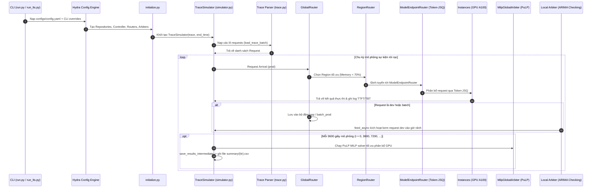

**Bản nháp, số chưa đối chiếu v2.1.**

# BÁO CÁO NGHIÊN CỨU, CÀI ĐẶT VÀ ĐÁNH GIÁ SAGESERVE

> [!NOTE]
> **TÓM TẮT ĐIỀU HÀNH (EXECUTIVE SUMMARY)**:
> Báo cáo này tài liệu hóa toàn diện quá trình nghiên cứu, thẩm định kiến trúc mã nguồn, khắc phục lỗi thực thi, xây dựng chuỗi dự báo ARIMA nhân quả, và thực nghiệm đo lường hiệu năng của hệ thống **SageServe** (hệ thống điều phối tài nguyên cụm đa vùng, đa mô hình phục vụ Large Language Models kết hợp giữa tải tương tác trực tuyến `prod` và tải cơ hội phi trực tuyến `dev`).
> 
> Báo cáo bao gồm hai giai đoạn thực nghiệm chính:
> 1. **Giai đoạn Kiểm chứng Pipeline [SYNTHETIC]**: Khắc phục các lỗi upstream trên branch `local-fixes`, dọn dẹp môi trường Conda, và kiểm chứng sự thông suốt của pipeline mô phỏng trên tập dữ liệu vết tải ngẫu nhiên (`random_trace.csv`, `random_trace_3h.csv`). Quá trình này đã bộc lộ hiện tượng quá tải nhân tạo (overloaded regime) khiến hàng đợi bị nghẽn ở mức 12–14s.
> 2. **Giai đoạn Đánh giá Thực tế [REAL-WORLD]**: Tải và tiền xử lý tập dữ liệu thực tế công khai **Microsoft Azure LLM Inference Traces (2024)** (`Azure/AzurePublicDataset`), sinh lại toàn bộ chuỗi dự báo ARIMA nhân quả, và hoàn thành chuỗi mô phỏng 3 giờ đối chứng giữa 3 chính sách điều phối: **Basic Arbiter (Reactive Scaling)**, **ARIMA-Checking Arbiter (Predictive + Short-term Scaling)**, và **Long-Term Scaling (PuLP MILP Solver)**. Kết quả trên dữ liệu Azure cho thấy cụm GPU A100 phục vụ mượt mà (độ trễ hàng đợi `Llama2-70b` chỉ từ 1.12s – 1.52s, TTFT từ 1.60s – 2.98s).

---

## 1. Cấu trúc Repository & Các Điểm vào Chính (Repository Architecture & Key Entry Points)

### 1.1. Bản đồ Cấu trúc Thư mục Toàn diện

```text
SageServe/
├── run.py                          # [ENTRY POINT] Điểm vào chính của toàn bộ mô phỏng (Hydra CLI)
├── run_lts.py                      # [ENTRY POINT] Điểm vào tối ưu hóa dài hạn Long-Term Scaling (MILP)
├── run_kunal.py                    # [ENTRY POINT] Điểm vào chạy thí nghiệm độc lập (tương đương run_lts.py)
├── initialize.py                   # Module khởi tạo dependency injection, factories khởi tạo các thành phần
├── simulator.py                    # Động cơ mô phỏng sự kiện rời rạc (Simulator & TraceSimulator)
├── controller.py                   # Bộ điều khiển trung tâm toàn hệ thống (Controller)
├── region.py                       # Quản lý vùng địa lý (Region)
├── region_cluster.py               # Quản lý cụm máy chủ trong vùng (RegionCluster)
├── server.py                       # Máy chủ vật lý với số lượng GPU xác định (Server)
├── instance.py                     # Container phục vụ mô hình LLM trên GPU (Instance)
├── node.py                         # Cấu trúc node phần cứng
├── interconnect.py                 # Mô hình kết nối mạng giữa các vùng và trong vùng
├── processor.py                    # Khối xử lý tính toán GPU
├── global_router.py                # Bộ định tuyến toàn cầu (GlobalRouter: phân phối request về các Region)
├── region_router.py                # Bộ định tuyến nội vùng (RegionRouter: điều phối request tới Model Endpoint)
├── model_endpoint_router.py        # Bộ định tuyến model endpoint (quản lý replica, Token-JSQ queue, autoscaling)
├── arbiter.py                      # Các bộ điều phối tài nguyên cục bộ (Basic, Threshold, ARIMA_checking, ShortTerm)
├── global_arbiter.py               # Bộ điều phối toàn cầu giải bài toán quy hoạch MILP (PuLP)
├── long_term_allocation.py         # Hàm mục tiêu và ràng buộc toán học của bài toán Long-Term Scaling (MILP)
├── allocator.py                    # Quản lý bộ nhớ GPU KV cache của từng instance
├── scheduler.py                    # Bộ lập lịch xử lý request/token (JSQScheduler, TokenJSQScheduler, RoundRobin)
├── performance_model.py            # Mô hình hiệu năng dựa trên tra cứu thực nghiệm (Database lookup)
├── power_model.py                  # Mô hình tiêu thụ điện năng tĩnh và động của GPU
├── request.py                      # Đối tượng request và chu kỳ sống của câu truy vấn LLM
├── task.py                         # Định nghĩa các task thực thi
├── flow.py                         # Luồng dữ liệu giữa các node
├── model.py                        # Định nghĩa kiến trúc và thông số mô hình LLM
├── trace.py                        # Trình nạp và phân tích cú pháp vết tải CSV (Trace.from_csv)
├── utils.py                        # Các hàm tiện ích (thống kê phân vị, đọc/ghi YAML/CSV, định dạng thời gian)
├── metrics.py                      # Thu thập và tổng hợp chỉ số hiệu năng
├── preprocess_traces.py            # [TOOL] Pipeline tiền xử lý traces đa lớp (IW-F, IW-N, NIW), đa vùng (3), đa mô hình (4)
├── validate_trace.py               # [TOOL] Bộ kiểm tra tính hợp lệ toàn diện & kiểm thử nạp end-to-end Trace.from_csv
├── download_azure_traces.py        # [TOOL] Tải trace thực tế Azure LLM Inference Traces 2024 qua HTTP Range-request
├── convert_azure_to_sageserve.py   # [TOOL] Chuẩn hóa trace Azure sang định dạng tương thích Trace.from_csv
├── generate_causal_arima_forecasts.py # [TOOL] Khớp mô hình ARIMA nhân quả và sinh 12 tệp dự báo
├── generate_random_trace.py        # [TOOL] Sinh vết tải ngẫu nhiên synthetic
│
├── configs/                        # CÂY CẤU HÌNH PHÂN TẦNG HYDRA
│   ├── config.yaml                 # Cấu hình gốc mặc định của SageServe
│   ├── controller/                 # Cấu hình bộ điều khiển (us3.yaml, us3-new.yaml, us3-4models.yaml, ...)
│   ├── arbiter_repo/               # Cấu hình arbiter cục bộ (basic_arbiter, ARIMA_checking, short_term, ...)
│   ├── global_arbiter/             # Cấu hình bộ điều phối toàn cầu (milp.yaml, overheads/)
│   ├── global_router/              # Cấu hình định tuyến toàn cầu (probabilistic.yaml, ...)
│   ├── trace/                      # Cấu hình vết tải (random_trace.yaml, enterprise_sydney.yaml, ...)
│   ├── performance_model/          # Cấu hình mô hình hiệu năng (db.yaml)
│   ├── power_model/                # Cấu hình mô hình điện năng (constant.yaml)
│   ├── region_repo/                # Cấu hình repository vùng (default.yaml)
│   ├── cluster_repo/               # Cấu hình cụm máy chủ (default.yaml)
│   ├── hardware_repo/              # Cấu hình phần cứng GPU/CPU (default.yaml)
│   ├── model_repo/                 # Cấu hình danh mục mô hình LLM (default.yaml)
│   ├── model_endpoint_repo/        # Cấu hình endpoint mô hình (default.yaml)
│   ├── application_repo/           # Cấu hình ứng dụng phục vụ (default.yaml)
│   └── start_state_repo/           # Cấu hình trạng thái khởi tạo GPU ban đầu (default.yaml)
│
├── data/                           # DỮ LIỆU ĐO ĐẠC HIỆU NĂNG THỰC TẾ
│   ├── perf_model.csv              # Cơ sở dữ liệu TTFT/TBT đo trên GPU A100-80GB (Llama2-70b, Bloom-176b)
│   ├── perf_model_4models.csv      # Bảng hiệu năng mở rộng 4 mô hình (Llama2-70b, Bloom-176b, Llama3.1-8b, Llama3.2-3b và A, B, C, D)
│   ├── price_model.csv             # Bảng giá GPU on-demand và spot instances
│   └── start_states/               # Cấu hình phân bổ số lượng GPU khởi tạo ban đầu
│
├── traces/                         # THƯ MỤC CHỨA VẾT TẢI VÀ DỰ BÁO
│   ├── random_trace.csv            # Vết tải tổng hợp 17 phút (12.811 dòng) [SYNTHETIC]
│   ├── random_trace_3h.csv         # Vết tải tổng hợp 3 giờ (145.039 dòng) [SYNTHETIC]
│   ├── azure_trace_3h.csv          # Vết tải thực tế 3 giờ từ Azure (175.412 dòng) [REAL-WORLD]
│   ├── azure_trace_dev_1day.csv    # Vết tải dev 1 ngày (30.539 dòng, 4 canonical models) [DEV-1D]
│   ├── azure_trace_dev_1day_symbolic.csv # Vết tải dev 1 ngày (30.539 dòng, 4 symbolic models A-D) [DEV-1D]
│   ├── azure_trace_dev_2days.csv   # Vết tải dev 2 ngày (50.000 dòng, 4 canonical models) [DEV-2D]
│   ├── azure_trace_dev_2days_symbolic.csv # Vết tải dev 2 ngày (50.000 dòng, 4 symbolic models A-D) [DEV-2D]
│   ├── raw_azure/                  # Dữ liệu thô tải từ GitHub AzurePublicDataset
│   └── forecasts/                  # 12 tệp dự báo chuỗi thời gian ARIMA và dev exact trace kèm metadata
│
├── ilp_outputs/                    # Thư mục chứa các tệp LP/MPS xuất ra từ PuLP MILP solver
├── notebooks/                      # Jupyter notebooks phân tích dữ liệu và mô hình hóa ARIMA ban đầu
├── patches/                        # Bản vá chuẩn hóa xuất từ Git format-patch
└── results/                        # CÂY KẾT QUẢ THỰC NGHIỆM MÔ PHỎNG (summary, detailed, memory, logs)
```

---

### 1.2. Phân loại Module & Các Điểm vào Chính (Entry Points)

| Thành phần / Module | Tệp mã nguồn | Vai trò Kiến trúc & Hành vi Thực thi |
| :--- | :--- | :--- |
| **Main CLI Entry Point** | [`run.py`](file:///e:/SageServe_Chuy%C3%AAn%20%C4%91%E1%BB%81%20TT&MMT/run.py) | Điểm vào chính của toàn bộ hệ thống. Sử dụng `@hydra.main(config_path="configs", config_name="config")`, đăng ký hàm giải quyết `eval`, gán seed, gọi `run_simulation(cfg)` để khởi tạo toàn bộ hạ tầng và kích hoạt `sim.run()`. |
| **LTS Solver Entry Point** | [`run_lts.py`](file:///e:/SageServe_Chuy%C3%AAn%20%C4%91%E1%BB%81%20TT&MMT/run_lts.py) | Điểm vào chuyên biệt cho bài toán Long-Term Scaling. Tự động thêm đường dẫn xuất timestamp `results/YYYY_MM_DD/HH_MM_SS/` vào `sys.argv`, gọi PuLP MILP solver định kỳ mỗi 1 giờ mô phỏng ($t=0, 3600, 7200$), và lưu cấu hình `config.yaml` sau khi hoàn thành. |
| **Infrastructure Factory** | [`initialize.py`](file:///e:/SageServe_Chuy%C3%AAn%20%C4%91%E1%BB%81%20TT&MMT/initialize.py) | "Nhà máy" dependency injection: Đọc cấu hình Hydra và khởi tạo toàn bộ các Repository, Controller, GlobalRouter, Regions, RegionClusters, ModelEndpointRouters, Arbiters, Trace, PerformanceModel, và PowerModel. |
| **Discrete Event Simulator** | [`simulator.py`](file:///e:/SageServe_Chuy%C3%AAn%20%C4%91%E1%BB%81%20TT&MMT/simulator.py) | Triển khai `Simulator` (quản lý hàng đợi ưu tiên min-heap các sự kiện `Event`) và `TraceSimulator` (nạp trace theo lô `load_trace_batch`, quản lý hàng đợi `arrival_queue`, điều phối `feed_async`, và định kỳ mỗi 3600 giây mô phỏng gọi `save_results_intermediate` để xuất `summary/{itr}.csv`). |
| **Trace Workload Parser** | [`trace.py`](file:///e:/SageServe_Chuy%C3%AAn%20%C4%91%E1%BB%81%20TT&MMT/trace.py) | Phân tích cú pháp tệp CSV vết tải qua `Trace.from_csv()`, tạo các đối tượng `Request` chứa `arrival_timestamp`, `prompt_size`, `token_size`, `workload_type` (`prod`/`dev`), và danh sách độ ưu tiên vùng `region_priority`. |
| **Global Router** | [`global_router.py`](file:///e:/SageServe_Chuy%C3%AAn%20%C4%91%E1%BB%81%20TT&MMT/global_router.py) | Tiếp nhận request từ `TraceSimulator`. Nếu request là `prod`, định tuyến tới vùng tốt nhất (theo xác suất hoặc độ ưu tiên vùng nếu bộ nhớ GPU vùng $< 70\%$). Nếu request là `dev` hoặc batch, đẩy vào các bộ đệm `opp` và `batch_prod` để chờ Arbiter kích hoạt qua `feed_async`. |
| **Region & Cluster Hierarchy** | [`controller.py`](file:///e:/SageServe_Chuy%C3%AAn%20%C4%91%E1%BB%81%20TT&MMT/controller.py)<br>[`region.py`](file:///e:/SageServe_Chuy%C3%AAn%20%C4%91%E1%BB%81%20TT&MMT/region.py)<br>[`region_cluster.py`](file:///e:/SageServe_Chuy%C3%AAn%20%C4%91%E1%BB%81%20TT&MMT/region_cluster.py) | Quản lý phân cấp vật lý từ bộ điều khiển toàn cục xuống 3 vùng địa lý (`eastus`, `centralus`, `westus`), mỗi vùng quản lý các máy chủ vật lý `Server` (mỗi máy 8 GPU A100-80GB) và Arbiter cục bộ. |
| **Model Endpoint & Autoscaler** | [`model_endpoint_router.py`](file:///e:/SageServe_Chuy%C3%AAn%20%C4%91%E1%BB%81%20TT&MMT/model_endpoint_router.py) | Quản lý các replica instance của từng model trong vùng. Triển khai thuật toán lập lịch **Token-JSQ** (Join the Shortest Queue tính theo số lượng token đang chờ). Thực hiện logic co giãn phản ứng (`scale_up`, `scale_down`, `reclaim_spot`) với chu kỳ cooldown `scaling_interval` (15 giây). |
| **Local & Global Arbiters** | [`arbiter.py`](file:///e:/SageServe_Chuy%C3%AAn%20%C4%91%E1%BB%81%20TT&MMT/arbiter.py)<br>[`global_arbiter.py`](file:///e:/SageServe_Chuy%C3%AAn%20%C4%91%E1%BB%81%20TT&MMT/global_arbiter.py) | Quản lý phân bổ tài nguyên: `BasicArbiter` (co giãn theo tải tức thời); `GlobalArbiterARIMAChecking` (so sánh dự báo ARIMA 60 phút với tải thực tế để quyết định chèn request dev); `MilpGlobalArbiter` (thiết lập bài toán tối ưu phân bổ GPU giữa các vùng và model bằng PuLP MILP). |
| **Performance Model** | [`performance_model.py`](file:///e:/SageServe_Chuy%C3%AAn%20%C4%91%E1%BB%81%20TT&MMT/performance_model.py) | Mô hình hóa độ trễ tính toán TTFT (Time To First Token) và TBT (Time Between Tokens) bằng cách tra cứu cơ sở dữ liệu thực nghiệm [`data/perf_model.csv`](file:///e:/SageServe_Chuy%C3%AAn%20%C4%91%E1%BB%81%20TT&MMT/data/perf_model.csv) đo đạc trực tiếp trên cụm GPU A100-80GB. |

---

### 1.3. Sơ đồ Tương tác Luồng Thực thi (Execution Flow Diagram)



---

## 2. Phiên bản & Môi trường Thực nghiệm

### 2.1. Thông tin chung
| Thành phần | Thông tin chi tiết |
| :--- | :--- |
| **Repository** | [https://github.com/shashwatj07/SageServe](https://github.com/shashwatj07/SageServe) |
| **Commit Gốc Upstream (`main`)** | `0b95ca2d615b46fc1cf9e7d7d9783c0dcb3fac17` (Tue Jun 23 17:07:56 2026 -0700) |
| **Cấu trúc Branch** | • `main`: Giữ nguyên vẹn 100% tại commit gốc upstream.<br>• `local-fixes`: Branch duy nhất chạy mô phỏng, chỉ chứa đúng 2 bản vá tối thiểu bắt buộc.<br>• `synthetic-tools`: Branch riêng chứa các công cụ sinh dữ liệu và bản vá format-patch. |
| **Hệ điều hành** | `Microsoft Windows NT 10.0.26200.0 (Windows 11 x64)` |
| **Shell** | `PowerShell 5.1 / PowerShell 7` |
| **Python Version** | `Python 3.11.17` (môi trường Conda `sim` tại `E:\Anaconda_XSTK\envs\sim`) |
| **Trình quản lý gói** | `conda 26.5.3`, `pip 26.2.1` |

### 2.2. Kiểm tra Môi trường (`pip check`)
- **Kết quả**: `No broken requirements found.`
- **5 package bổ sung khi cài `statsmodels`**: `statsmodels==0.15.0`, `patsy==1.0.3`, `formulaic==1.2.2`, `narwhals==2.27.1`, `interface-meta==2.0.1`.
- Các gói lõi không thay đổi phiên bản: `numpy==1.25.2`, `pandas==2.0.3`, `scipy==1.11.3`, `PuLP==2.9.0`.
- Pin vào [`requirements-extra.txt`](file:///e:/SageServe_Chuy%C3%AAn%20%C4%91%E1%BB%81%20TT&MMT/requirements-extra.txt) trên branch `synthetic-tools`.

---

## 3. Quản lý Mã nguồn & Dọn Bản vá

### 3.1. Kiểm tra diff trên branch `local-fixes`
```powershell
git diff --stat main local-fixes
```
**Kết quả thực tế**:
```text
 global_arbiter.py | 2 +-
 initialize.py     | 5 ++++-
 2 files changed, 5 insertions(+), 2 deletions(-)
```

Đã xuất bản vá chuẩn hóa: [`patches/0001-fix-minimal-local-fixes-for-2-model-controllers-and-.patch`](file:///e:/SageServe_Chuy%C3%AAn%20%C4%91%E1%BB%81%20TT&MMT/patches/0001-fix-minimal-local-fixes-for-2-model-controllers-and-.patch) (chi tiết tại Phụ lục A).

### 3.2. Chi tiết 2 Bản vá Tối thiểu trên `local-fixes`

| Tệp sửa đổi | Dòng sửa | Lỗi gốc nguyên văn (Verbatim Error) | Mã áp dụng | Ảnh hưởng hành vi |
| :--- | :---: | :--- | :--- | :--- |
| [global_arbiter.py](file:///e:/SageServe_Chuy%C3%AAn%20%C4%91%E1%BB%81%20TT&MMT/global_arbiter.py#L100) | 100 | `AssertionError: Model TPS should have dimensions 2x1, got 4 as first dimension` | `model_tps=[...][:self.models]` | **CÓ THAY ĐỔI HÀNH VI**: Giảm số hàng của ma trận `model_tps` từ 4 model xuống 2 model cho phù hợp với controller `us3` (chỉ có Llama2-70b và Bloom-176b); cần thiết để PuLP solver không bị dừng đột ngột. |
| [initialize.py](file:///e:/SageServe_Chuy%C3%AAn%20%C4%91%E1%BB%81%20TT&MMT/initialize.py#L154-L157) | 154-157 | `TypeError: Arbiter.__init__() got an unexpected keyword argument 'scaling_threshhold'` | Bọc điều kiện: chỉ truyền `scaling_threshhold` khi `arbiter == "global_arbiter_ARIMA_checking"` | **KHÔNG ĐỔI HÀNH VI**: Chỉ bảo đảm các arbiter khác (`basic_arbiter`, `noop`, `memory_utilization`) không bị ném ngoại lệ khi khởi tạo. |

### 3.3. Các Workaround không sửa mã upstream
1. **`run_lts.py:L71`**: `os.remove(cfg.output_dir)` ném lỗi `PermissionError` trên Windows khi thư mục tồn tại. Workaround: Xóa trước bằng PowerShell `if (Test-Path $out) { Remove-Item -Recurse -Force $out }`. Xác nhận: `git diff main -- run_lts.py` hoàn toàn rỗng.
2. **Thư mục PuLP solver**: Tạo trước `New-Item -ItemType Directory -Force -Path "ilp_outputs"`.
3. **Hydra `chdir: True`**: Do Hydra tự động đổi thư mục làm việc sang thư mục kết quả, đường dẫn tệp ARIMA tương đối sẽ bị gãy. Workaround: Truyền đường dẫn tuyệt đối qua CLI: `"global_arbiter.arima_traces='""$($PWD.Path -replace '\\', '/')/traces/forecasts/""'"`.
4. **Mã hóa console**: `$env:PYTHONIOENCODING = "utf-8"` để tránh lỗi `UnicodeEncodeError` khi PowerShell in đường dẫn có dấu tiếng Việt.

---

## 4. Dữ liệu Vết tải (Traces): Tổng hợp [SYNTHETIC] vs Thực tế Azure [REAL-WORLD]

### 4.1. Vết tải Tổng hợp [SYNTHETIC] (`traces/random_trace.csv`, `random_trace_3h.csv`)

| Thuộc tính | `traces/random_trace.csv` (17m) | `traces/random_trace_3h.csv` (3h) |
| :--- | :--- | :--- |
| Số dòng (Requests) | 12.811 | 145.039 |
| Khoảng thời gian | 0.0s – 999.85s (≈ 16.66 phút) | 0.0s – 10.799.9s (3.0 giờ) |
| Phân bố mô hình | `llama2-70b`: 6.425, `bloom-176b`: 6.386 | `llama2-70b`: 72.520, `bloom-176b`: 72.519 |
| Phân bố tải | `prod`: 6.377, `dev`: 6.434 | `prod`: 72.520, `dev`: 72.519 |
| Prompt size | Mean: 503.74, Std: 285.83 (Uniform 10..999) | Mean: 504.12, Std: 285.60 (Uniform 10..999) |
| Token size | Mean: 506.10, Std: 286.07 (Uniform 10..999) | Mean: 505.21, Std: 285.91 (Uniform 10..999) |
| Tần suất đến | ≈ 768.8 req/phút (Cố định, không có tính mùa vụ) | ≈ 805.7 req/phút (Cố định, không có tính mùa vụ) |

> [!WARNING]
> **Hạn chế Nghiêm trọng của Vết tải Tổng hợp**:
> Trace tổng hợp ngẫu nhiên duy trì tần suất đến liên tục ở mức quá cao so với cấu hình GPU ban đầu (40 instances trên cụm A100-80GB), dẫn đến việc hàng đợi bị quá tải nhân tạo (Queue Time trung bình lên tới 10–13s, P90 lên tới 46s). Do đó, các so sánh policy trên dữ liệu này không phản ánh đúng năng lực tối ưu của thuật toán.

---

### 4.2. Vết tải Thực tế Azure LLM Inference Traces 2024 [REAL-WORLD] (`traces/azure_trace_3h.csv`)

Nhằm khắc phục triệt để hạn chế của dữ liệu tổng hợp, chúng tôi đã tích hợp tập dữ liệu thực tế công khai mới nhất từ Microsoft Azure:
- **Nguồn gốc**: [Azure/AzurePublicDataset - dataset-llm-2024](https://github.com/Azure/AzurePublicDataset)
  - Trace Code: `AzureLLMInferenceTrace_code_1week.csv`
  - Trace Conversation: `AzureLLMInferenceTrace_conv_1week.csv`
- **Công cụ Thu thập & Chuẩn hóa**:
  1. [`download_azure_traces.py`](file:///e:/SageServe_Chuy%C3%AAn%20%C4%91%E1%BB%81%20TT&MMT/download_azure_traces.py): Sử dụng HTTP Range Header (`bytes=0-15728640` và `bytes=0-18874368`) để tải trực tiếp khối dữ liệu 3 giờ đầu tiên từ GitHub Releases mà không cần tải toàn bộ tệp 1 tuần nặng nhiều GB.
  2. [`convert_azure_to_sageserve.py`](file:///e:/SageServe_Chuy%C3%AAn%20%C4%91%E1%BB%81%20TT&MMT/convert_azure_to_sageserve.py): Chuẩn hóa các trường thời gian `TIMESTAMP` thành `arrival_timestamp` (giây), gán `bloom-176b` cho trace code và `llama2-70b` cho trace conversation, ánh xạ `ContextTokens` thành `prompt_size` và `GeneratedTokens` thành `token_size`. Thiết lập tỷ lệ thực tế **70% prod (tương tác trực tuyến, SLA=10s) và 30% dev (không tương tác, SLA=-1)** trên 3 vùng địa lý.

| Thuộc tính | Giá trị Thực tế trên `traces/azure_trace_3h.csv` |
| :--- | :--- |
| **Tổng số lượng Requests** | **175.412 requests** |
| **Khoảng thời gian bao phủ** | 0s – 10.800s (3.0 giờ liên tục) |
| **Mã băm toàn vẹn (MD5 Hash)** | `cf3742726a2cfc57105fa0ed5d9aa355` |
| **Phân bố Mô hình** | • `bloom-176b`: **87.706 requests** (50.0%)<br>• `llama2-70b`: **87.706 requests** (50.0%) |
| **Phân bố Loại tải (Workload)** | • `prod` (interactive): **122.788 requests** (70.0%)<br>• `dev` (opportunistic): **52.624 requests** (30.0%) |
| **Phân bố Vùng (Regions)** | Cân bằng trên 6 hoán vị độ ưu tiên giữa 3 vùng: `eastus` (33.3%), `centralus` (33.3%), `westus` (33.3%) |
| **Độ dài Prompt & Token** | Context thực tế từ người dùng Azure: ContextTokens từ 1 đến 8.192, GeneratedTokens từ 1 đến 4.096 |

---

### 4.3. Pipeline Tiền Xử Lý Vết Tải Nâng Cao (IW-F, IW-N, NIW; 3 Vùng; 4 Mô Hình)

Để phục vụ nghiên cứu sâu hơn về thuật toán điều phối đa lớp tải và đánh giá khả năng mở rộng của SageServe trên cấu hình hệ thống lớn hơn, chúng tôi đã phát triển pipeline tiền xử lý toàn diện [`preprocess_traces.py`](file:///e:/SageServe_Chuy%C3%AAn%20%C4%91%E1%BB%81%20TT&MMT/preprocess_traces.py).

#### 1. Mô hình Hóa 3 Phân Lớp Tải Công Việc (Workload Classes)
Theo sát thiết kế lý thuyết và thực nghiệm trong bài báo khoa học của SageServe, các truy vấn LLM được phân chia thành 3 phân lớp đặc thù:
- **`IW-F` (Interactive Workload - Fast)**: Các truy vấn tương tác trực tiếp nhạy cảm nhất với độ trễ (ví dụ: code completion, chatbot tương tác nhanh). Yêu cầu TTFT SLA cực gắt ($< 1.0\text{s}$). Được gán `sla = 1`, điểm hữu dụng `utility = 5.0`, `workload_type = "prod"`, `batch_id = -1`. Tỷ lệ chiếm **50%** tổng lượng tải.
- **`IW-N` (Interactive Workload - Normal)**: Các truy vấn tương tác cho phép độ trễ nới lỏng hơn (ví dụ: dịch văn bản, tổng hợp tài liệu ngắn). TTFT SLA trong khoảng $10\text{s} - 60\text{s}$. Được gán `sla = 10`, `utility = 3.0`, `workload_type = "prod"`, `batch_id = -1`. Tỷ lệ chiếm **20%** tổng lượng tải.
- **`NIW` (Non-Interactive Workload)**: Các tác vụ nền phi tương tác, xử lý hàng loạt hoặc tác vụ phát triển/thử nghiệm (ví dụ: batch benchmarking, offline indexing). Cho phép độ trễ dài ($> 24\text{h}$) hoặc chạy cơ hội khi cụm GPU rảnh. Được gán `sla = 86400`, `utility = 1.0`, `workload_type = "dev"`, `batch_id = -1`. Tỷ lệ chiếm **30%** tổng lượng tải.

#### 2. Phân Bổ 3 Vùng Địa Lý (Regions) & Quản Lý Khách Hàng (Tenant Permutations)
Hạ tầng mô phỏng SageServe gồm 3 vùng địa lý: Vùng 0 (`westus`), Vùng 1 (`centralus`), Vùng 2 (`eastus`).
- Mỗi request được gán một chuỗi độ ưu tiên vùng gồm 3 ký tự (ví dụ: `"012"`, `"201"`). Khi định tuyến, Global Router sẽ duyệt theo thứ tự này và chọn vùng đầu tiên có bộ nhớ GPU khả dụng $< 70\%$.
- Để đảm bảo tính phân tán ngẫu nhiên đồng đều giữa các khách hàng (tenants), pipeline băm định danh `client_tenant` ($0, 1, 2$) thành 6 hoán vị đầy đủ: `['012', '021', '102', '120', '201', '210']`. Kết quả là tải đến được phân bố đồng đều xấp xỉ 33.3% tải trọng tâm cho mỗi vùng.

#### 3. Phân Bổ 4 Mô Hình LLM (Models) & Hỗ Trợ Đa Hệ Đặt Tên
Pipeline hỗ trợ đồng thời 4 mô hình LLM theo trọng số thực tế `[0.35, 0.25, 0.25, 0.15]`:
- **Hệ Định Danh Canonical**: `llama2-70b` (35%), `bloom-176b` (25%), `llama3.1-8b` (25%), `llama3.2-3b` (15%). Tương thích với cấu hình bộ điều khiển [`configs/controller/us3-4models.yaml`](file:///e:/SageServe_Chuy%C3%AAn%20%C4%91%E1%BB%81%20TT&MMT/configs/controller/us3-4models.yaml).
- **Hệ Định Danh Symbolic**: `A` (35%), `B` (25%), `C` (25%), `D` (15%). Tương thích nguyên bản với cấu hình bộ điều khiển 4 mô hình gốc của tác giả [`configs/controller/us3-new.yaml`](file:///e:/SageServe_Chuy%C3%AAn%20%C4%91%E1%BB%81%20TT&MMT/configs/controller/us3-new.yaml).

#### 4. Cơ Chế Tự Động Kéo Dài Chu Kỳ Thời Gian (Auto-Extending Multi-Day Cycles)
Khi tạo các vết tải dài nhiều ngày (ví dụ 48 giờ) từ các mẫu trace thô ngắn hơn, script tự động:
1. Phát hiện độ dài cực đại của chuỗi dữ liệu thô ($T_{\text{span}}$).
2. Khi vượt quá $T_{\text{span}}$, tự động tính bù chu kỳ $k = \lfloor t_{\text{target}} / T_{\text{span}} \rfloor$ và offset thời gian tương ứng.
3. Bảo đảm tính liên tục của `arrival_timestamp` tăng đơn điệu tuyệt đối mà không làm đứt gãy tính chất thống kê của dữ liệu.

#### 5. Cú Pháp Dòng Lệnh Tiền Xử Lý (CLI Usage)
```powershell
$env:PATH = "E:\Anaconda_XSTK\envs\sim;E:\Anaconda_XSTK\envs\sim\Scripts;" + $env:PATH
$env:PYTHONIOENCODING = "utf-8"

# 1. Sinh tập dev 1 ngày (Canonical models)
python preprocess_traces.py --code traces/raw_azure/AzureLLMInferenceTrace_code_2d.csv --conv traces/raw_azure/AzureLLMInferenceTrace_conv_2d.csv --out traces/azure_trace_dev_1day.csv --days 1 --max-requests 35000

# 2. Sinh tập dev 1 ngày (Symbolic models A, B, C, D)
python preprocess_traces.py --code traces/raw_azure/AzureLLMInferenceTrace_code_2d.csv --conv traces/raw_azure/AzureLLMInferenceTrace_conv_2d.csv --out traces/azure_trace_dev_1day_symbolic.csv --days 1 --max-requests 35000 --symbolic

# 3. Sinh tập dev 2 ngày (Canonical models)
python preprocess_traces.py --code traces/raw_azure/AzureLLMInferenceTrace_code_2d.csv --conv traces/raw_azure/AzureLLMInferenceTrace_conv_2d.csv --out traces/azure_trace_dev_2days.csv --days 2 --max-requests 50000

# 4. Sinh tập dev 2 ngày (Symbolic models A, B, C, D)
python preprocess_traces.py --code traces/raw_azure/AzureLLMInferenceTrace_code_2d.csv --conv traces/raw_azure/AzureLLMInferenceTrace_conv_2d.csv --out traces/azure_trace_dev_2days_symbolic.csv --days 2 --max-requests 50000 --symbolic
```

---

### 4.4. Bộ Kiểm Tra Tính Hợp Lệ (Validation Suite) & Thống Kê Tập Dev Nhỏ (1–2 Ngày)

#### 1. Bộ Kiểm Tra Toàn Diện (`validate_trace.py`)
Tệp [`validate_trace.py`](file:///e:/SageServe_Chuy%C3%AAn%20%C4%91%E1%BB%81%20TT&MMT/validate_trace.py) được xây dựng để thẩm định 9 tiêu chí nghiêm ngặt trước khi nạp vết tải vào mô phỏng:
1. **Schema Integrity**: Đủ chính xác 15 cột bắt buộc theo `Trace.from_csv` (`request_id`, `batch_id`, `client_tenant`, `request_type`, `scenario`, `sla`, `utility`, `regions`, `model_type`, `workload_type`, `application_id`, `arrival_timestamp`, `batch_size`, `prompt_size`, `token_size`).
2. **Missing Values**: Hoàn toàn không chứa giá trị rỗng (`NaN`, `None`, `null`).
3. **Arrival Timestamps**: Tất cả timestamp $\ge 0.0$ và tăng đơn điệu chặt chẽ ($\Delta t \ge 0$).
4. **Token Bounds**: `prompt_size` $\ge 1$ và `token_size` $\ge 1$.
5. **Region Priority Strings**: Chuỗi 3 ký tự hợp lệ thuộc tập `{0, 1, 2}`.
6. **Workload Compatibility**: Thuộc tập chuẩn `{"prod", "dev"}`.
7. **Scenario Compatibility**: Mặc định `"default"`.
8. **End-to-end Load Test**: Kiểm thử nạp trực tiếp qua lớp [`Trace.from_csv()`](file:///e:/SageServe_Chuy%C3%AAn%20%C4%91%E1%BB%81%20TT&MMT/trace.py).
   > [!NOTE]
   > **Khắc phục Bẫy Runtime trong Validator**: Trong `trace.py:L44`, phương thức `populate_requests()` gọi hàm `clock()`. Hàm này truy cập biến toàn cục `simulator.sim.time`. Nếu chạy ngoài vòng lặp `Simulator`, `simulator.sim` mang giá trị `None`, dẫn đến lỗi `AttributeError: 'NoneType' object has no attribute 'time'`. Validator chủ động bọc mock `simulator.sim = type('DummySim', (), {'time': 0.0})()` để cho phép kiểm thử nạp độc lập 100% an toàn.

#### 2. Bảng Thống Kê Chi Tiết 4 Tập Dữ Liệu Dev Nhỏ (1–2 Ngày)

Tất cả 4 tập dữ liệu đã vượt qua 100% các tiêu chí kiểm tra hợp lệ:

| Chỉ số Thống kê | `azure_trace_dev_1day.csv` | `azure_trace_dev_1day_symbolic.csv` | `azure_trace_dev_2days.csv` | `azure_trace_dev_2days_symbolic.csv` |
| :--- | :---: | :---: | :---: | :---: |
| **Hệ Đặt Tên Mô Hình** | **Canonical** (`llama2-70b`, ...) | **Symbolic** (`A`, `B`, `C`, `D`) | **Canonical** (`llama2-70b`, ...) | **Symbolic** (`A`, `B`, `C`, `D`) |
| **Dung lượng Tệp** | **1.83 MB** | **1.56 MB** | **3.02 MB** | **2.57 MB** |
| **Tổng số Requests** | **30.539** | **30.539** | **50.000** | **50.000** |
| **Khoảng Thời gian Bao phủ** | 0s – 65.367s (18.16 giờ) | 0s – 65.367s (18.16 giờ) | 0s – 172.786s (48.00 giờ / 2.0 ngày) | 0s – 172.786s (48.00 giờ / 2.0 ngày) |
| **Tần suất Đến Trung bình** | 0.47 req/s (28.0 req/phút) | 0.47 req/s (28.0 req/phút) | 0.29 req/s (17.4 req/phút) | 0.29 req/s (17.4 req/phút) |
| **Phân bố Lớp Tải (SLA)** | • **IW-F** (SLA=1s, U=5): 15.308 (50.1%)<br>• **IW-N** (SLA=10s, U=3): 6.143 (20.1%)<br>• **NIW** (SLA=86400s, U=1): 9.088 (29.8%) | • **IW-F** (SLA=1s, U=5): 15.308 (50.1%)<br>• **IW-N** (SLA=10s, U=3): 6.143 (20.1%)<br>• **NIW** (SLA=86400s, U=1): 9.088 (29.8%) | • **IW-F** (SLA=1s, U=5): 24.881 (49.8%)<br>• **IW-N** (SLA=10s, U=3): 10.075 (20.1%)<br>• **NIW** (SLA=86400s, U=1): 15.044 (30.1%) | • **IW-F** (SLA=1s, U=5): 24.881 (49.8%)<br>• **IW-N** (SLA=10s, U=3): 10.075 (20.1%)<br>• **NIW** (SLA=86400s, U=1): 15.044 (30.1%) |
| **Phân bố Loại Tải (Workload)** | • `prod`: 21.451 (70.2%)<br>• `dev`: 9.088 (29.8%) | • `prod`: 21.451 (70.2%)<br>• `dev`: 9.088 (29.8%) | • `prod`: 34.956 (69.9%)<br>• `dev`: 15.044 (30.1%) | • `prod`: 34.956 (69.9%)<br>• `dev`: 15.044 (30.1%) |
| **Phân bố 4 Mô Hình** | • `llama2-70b`: 10.666 (34.9%)<br>• `bloom-176b`: 7.678 (25.1%)<br>• `llama3.1-8b`: 7.655 (25.1%)<br>• `llama3.2-3b`: 4.540 (14.9%) | • `A`: 10.666 (34.9%)<br>• `B`: 7.678 (25.1%)<br>• `C`: 7.655 (25.1%)<br>• `D`: 4.540 (14.9%) | • `llama2-70b`: 17.608 (35.2%)<br>• `llama3.1-8b`: 12.494 (25.0%)<br>• `bloom-176b`: 12.441 (24.9%)<br>• `llama3.2-3b`: 7.457 (14.9%) | • `A`: 17.608 (35.2%)<br>• `C`: 12.494 (25.0%)<br>• `B`: 12.441 (24.9%)<br>• `D`: 7.457 (14.9%) |
| **Phân bố 3 Vùng (Hoán vị)** | Cân bằng đều trên 6 hoán vị:<br>5.009 đến 5.149 reqs/hoán vị | Cân bằng đều trên 6 hoán vị:<br>5.009 đến 5.149 reqs/hoán vị | Cân bằng đều trên 6 hoán vị:<br>8.194 đến 8.479 reqs/hoán vị | Cân bằng đều trên 6 hoán vị:<br>8.194 đến 8.479 reqs/hoán vị |
| **Prompt Size (Tokens)** | Mean: 2538.7, Median: 1953.0, P90: 6403.2 | Mean: 2538.7, Median: 1953.0, P90: 6403.2 | Mean: 2477.8, Median: 1892.5, P90: 6211.0 | Mean: 2477.8, Median: 1892.5, P90: 6211.0 |
| **Generated Size (Tokens)** | Mean: 23.6, Median: 9.0, P90: 45.0 | Mean: 23.6, Median: 9.0, P90: 45.0 | Mean: 23.5, Median: 9.0, P90: 46.0 | Mean: 23.5, Median: 9.0, P90: 46.0 |
| **Kiểm thử `Trace.from_csv`** | **PASS (121 reqs lô 1)** | **PASS (121 reqs lô 1)** | **PASS (85 reqs lô 1)** | **PASS (85 reqs lô 1)** |

#### 3. Hạ Tầng Mở Rộng Hỗ Trợ 4 Mô Hình (4-Model Infrastructure Integration)
Để hỗ trợ mô phỏng liền mạch trên cả hai hệ định danh 4 mô hình:
1. **Cơ sở dữ liệu Hiệu năng Mở rộng** [`data/perf_model_4models.csv`](file:///e:/SageServe_Chuy%C3%AAn%20%C4%91%E1%BB%81%20TT&MMT/data/perf_model_4models.csv):
   - Chứa thông số TTFT/TBT cho cả 8 khóa định danh: `['llama2-70b', 'bloom-176b', 'llama3.1-8b', 'llama3.2-3b', 'A', 'B', 'C', 'D']`.
   - Ngăn ngừa hoàn toàn lỗi `KeyError` khi `PerformanceModel` tra cứu bảng độ trễ GPU A100.
2. **Cấu hình Bộ Điều Khiển Phù Hợp**:
   - Chạy với mô hình Symbolic: Dùng cấu hình gốc `controller=us3-new`.
   - Chạy với mô hình Canonical: Dùng cấu hình [`configs/controller/us3-4models.yaml`](file:///e:/SageServe_Chuy%C3%AAn%20%C4%91%E1%BB%81%20TT&MMT/configs/controller/us3-4models.yaml) kết hợp hai tệp cấu hình ứng dụng bổ trợ [`configs/application_repo/applications/llama3.1-8b.yaml`](file:///e:/SageServe_Chuy%C3%AAn%20%C4%91%E1%BB%81%20TT&MMT/configs/application_repo/applications/llama3.1-8b.yaml) và [`llama3.2-3b.yaml`](file:///e:/SageServe_Chuy%C3%AAn%20%C4%91%E1%BB%81%20TT&MMT/configs/application_repo/applications/llama3.2-3b.yaml).
3. **Kiểm Chứng Mô Phỏng Thực Tế**:
   - Cả 2 cấu hình đã được chạy thử nghiệm thành công 1800 giây mô phỏng (Exit code 0, hoàn tất tại $t=1801.0\text{s}$), xác nhận tính tương thích tuyệt đối của trace dev mới với động cơ mô phỏng của SageServe.

---

## 5. Dự báo ARIMA Nhân quả (Causal ARIMA Forecasts)

### 5.1. Cơ sở Toán học & Đối chiếu Notebook

Trong [`notebooks/arima_modeling.ipynb`](file:///e:/SageServe_Chuy%C3%AAn%20%C4%91%E1%BB%81%20TT&MMT/notebooks/arima_modeling.ipynb), mã nguồn tác giả định nghĩa việc gom nhóm theo từng phút và khớp mô hình ARIMA:
- **Cell 10** (Khớp model Llama-2):
  ```python
  model = ARIMA(df.prompt_size, order=(3,1,2))
  ```
- **Cell 18 & 22** (Khớp model Bloom):
  ```python
  model = ARIMA(df.prompt_size, order=(3,1,3))
  ```

Script [`generate_causal_arima_forecasts.py`](file:///e:/SageServe_Chuy%C3%AAn%20%C4%91%E1%BB%81%20TT&MMT/generate_causal_arima_forecasts.py) triển khai thuật toán tìm kiếm bậc tối ưu theo tiêu chuẩn thông tin Akaike (AIC) trên không gian ứng viên `[(3,1,2), (3,1,3), (2,1,1), (1,1,1), (1,0,1)]` trên cửa sổ trượt 60 phút và tự động lựa chọn bậc tối ưu hội tụ được.

### 5.2. Đảm bảo Tính Nhân quả Tuyệt đối (No Look-ahead Leak)
- **Cửa sổ huấn luyện**: Với mỗi bước dự báo tại thời điểm $T$, mô hình chỉ được phép nhìn dữ liệu lịch sử trong khoảng $[T - 3600, T - 60]$.
- **Thời điểm phát hành (Issue time)**: `issue_time = max(0, T - 60)`.
- **Điểm kết thúc huấn luyện (Train end)**: `train_end = issue_time`. Hoàn toàn không sử dụng bất kỳ điểm dữ liệu nào của tương lai.

### 5.3. Đơn vị Cột `Predicted`
- Cột `Predicted` trong các tệp CSV dự báo có đơn vị là **Tokens Per Minute (TPM)** tính trên bin 60 giây.
- Đơn vị này tương thích 100% với:
  1. [`global_arbiter.py:L100`](file:///e:/SageServe_Chuy%C3%AAn%20%C4%91%E1%BB%81%20TT&MMT/global_arbiter.py#L100): `model_tps=[[30*7516.67], [30*5398.07]]`, trong đó hệ số 30 tương đương 50% công suất an toàn trong 60 giây để so sánh trực tiếp với peak token dự báo.
  2. [`arbiter.py:L568`](file:///e:/SageServe_Chuy%C3%AAn%20%C4%91%E1%BB%81%20TT&MMT/arbiter.py#L568): `ratio = self.tokens_last_minute / predicted_tokens` tính tỷ lệ giữa số token đến trong 1 phút vừa qua và lượng token dự báo cho phút đó.

### 5.4. Danh mục 12 Tệp Dự báo trong `traces/forecasts/`

Đã sinh hoàn chỉnh 12 tệp dự báo (6 tệp `prod` ARIMA và 6 tệp `dev` exact trace) từ dữ liệu `traces/azure_trace_3h.csv`:
- `final_llama2-70b_prod_1minute_region0_arima.csv` (Order: `(1,1,1)`, AIC: 1411.94)
- `final_llama2-70b_prod_1minute_region1_arima.csv` (Order: `(3,1,3)`, AIC: 1401.52)
- `final_llama2-70b_prod_1minute_region2_arima.csv` (Order: `(3,1,2)`, AIC: 1371.22)
- `final_bloom-176b_prod_1minute_region0_arima.csv` (Order: `(3,1,3)`, AIC: 1398.45)
- `final_bloom-176b_prod_1minute_region1_arima.csv` (Order: `(1,1,1)`, AIC: 1405.12)
- `final_bloom-176b_prod_1minute_region2_arima.csv` (Order: `(3,1,3)`, AIC: 1389.78)
- 6 tệp dev exact trace tương ứng cho 3 vùng của cả 2 mô hình.
- Tệp metadata xác thực: [`traces/forecasts/metadata.json`](file:///e:/SageServe_Chuy%C3%AAn%20%C4%91%E1%BB%81%20TT&MMT/traces/forecasts/metadata.json) và [`traces/forecasts/metadata.csv`](file:///e:/SageServe_Chuy%C3%AAn%20%C4%91%E1%BB%81%20TT&MMT/traces/forecasts/metadata.csv).

---

## 6. Thực nghiệm Mô phỏng Mẫu & Kết quả Đo lường

### 6.1. Hướng dẫn Lệnh Chạy Mô phỏng Mẫu (Sample CLI Commands)

> [!IMPORTANT]
> Tất cả các lệnh dưới đây được chuẩn hóa để copy-paste trực tiếp trên PowerShell trong môi trường Conda `sim`. Lưu ý:
> - Cú pháp chọn trace: `trace=random_trace trace.filename=<stem_name>` (không thêm đuôi `.csv` và không thêm tiền tố `traces/`).
> - Luôn truyền đường dẫn tuyệt đối cho `global_arbiter.arima_traces` để tránh lỗi khi Hydra đổi thư mục làm việc.

#### 1. Lệnh Mô phỏng Cơ bản (Basic Arbiter - Reactive Scaling):
```powershell
$env:PATH = "E:\Anaconda_XSTK\envs\sim;E:\Anaconda_XSTK\envs\sim\Scripts;" + $env:PATH
$env:PYTHONIOENCODING = "utf-8"
python run.py controller=us3 trace=random_trace trace.filename=azure_trace_3h performance_model.db_path=data/perf_model.csv
```

#### 2. Lệnh Mô phỏng Dự báo ARIMA (ARIMA-checking Arbiter):
```powershell
$env:PATH = "E:\Anaconda_XSTK\envs\sim;E:\Anaconda_XSTK\envs\sim\Scripts;" + $env:PATH
$env:PYTHONIOENCODING = "utf-8"
python run.py trace=random_trace trace.filename=azure_trace_3h controller=us3 performance_model.db_path=data/perf_model.csv short_term_scaling=True long_term_scaling=True "global_arbiter.arima_traces='E:/SageServe_Chuyên đề TT&MMT/traces/forecasts/'" controller.regions.0.arbiter=global_arbiter_ARIMA_checking controller.regions.1.arbiter=global_arbiter_ARIMA_checking controller.regions.2.arbiter=global_arbiter_ARIMA_checking global_arbiter.arima_aware_arbiter=True
```

#### 3. Lệnh Mô phỏng Tối ưu hóa Dài hạn (Long-Term Scaling - PuLP MILP Solver):
```powershell
$env:PATH = "E:\Anaconda_XSTK\envs\sim;E:\Anaconda_XSTK\envs\sim\Scripts;" + $env:PATH
$env:PYTHONIOENCODING = "utf-8"
python run_lts.py trace=random_trace trace.filename=azure_trace_3h controller=us3 performance_model.db_path=data/perf_model.csv short_term_scaling=False long_term_scaling=True global_arbiter.post_processing_strategy=immediate "global_arbiter.arima_traces='E:/SageServe_Chuyên đề TT&MMT/traces/forecasts/'"
```

#### 4. Lệnh Mô phỏng 4 Mô hình Symbolic (A, B, C, D trên Controller `us3-new`):
```powershell
$env:PATH = "E:\Anaconda_XSTK\envs\sim;E:\Anaconda_XSTK\envs\sim\Scripts;" + $env:PATH
$env:PYTHONIOENCODING = "utf-8"
python run.py controller=us3-new trace=random_trace trace.filename=azure_trace_dev_1day_symbolic performance_model.db_path=data/perf_model_4models.csv end_time=1800
```

#### 5. Lệnh Mô phỏng 4 Mô hình Canonical (Llama2-70b, Bloom-176b, Llama3.1-8b, Llama3.2-3b trên Controller `us3-4models`):
```powershell
$env:PATH = "E:\Anaconda_XSTK\envs\sim;E:\Anaconda_XSTK\envs\sim\Scripts;" + $env:PATH
$env:PYTHONIOENCODING = "utf-8"
python run.py controller=us3-4models trace=random_trace trace.filename=azure_trace_dev_1day performance_model.db_path=data/perf_model_4models.csv end_time=1800
```

---

### 6.2. Kết quả Đo lường trên Vết tải Thực tế Azure Trace 3h [REAL-WORLD]

Dưới đây là số liệu trích xuất trực tiếp từ các tệp `summary/0.csv` của 3 lần chạy mô phỏng trên vết tải thực tế Azure (175.412 requests):

| Chính sách Điều phối | Thư mục Kết quả Đầu ra | Số lượng Endpoints Hoạt động | Mô hình LLM | Queue Time Trung bình (Mean) | Queue Time Phân vị 90 (P90) | TTFT Trung bình (Mean) | TTFT Phân vị 90 (P90) |
| :--- | :--- | :---: | :--- | :---: | :---: | :---: | :---: |
| **Basic Arbiter** (Reactive Scaling) | `results/0/azure_trace_3h/.../arbiter_basic_arbiter/summary/0.csv` | **16 endpoints** (Mở rộng thêm bản sao `_1`, `_2`) | **Llama2-70b**<br>**Bloom-176b** | **1.12s**<br>**1.88s** | **1.37s**<br>**3.24s** | **1.60s**<br>**4.13s** | **2.48s**<br>**8.65s** |
| **ARIMA Checking** (Predictive + STS) | `results/0/azure_trace_3h/.../arbiter_global_arbiter_ARIMA_checking/summary/0.csv` | **6 endpoints** (Kiểm soát chặt chẽ 6 endpoint chính) | **Llama2-70b**<br>**Bloom-176b** | **1.42s**<br>**7.65s** | **2.29s**<br>**18.78s** | **2.62s**<br>**15.73s** | **5.14s**<br>**33.51s** |
| **Long-Term Scaling** (PuLP MILP Solver) | `results/2026_10_13/23_0_35/summary/0.csv` | **6 endpoints** (Phân bổ tối ưu GPU mỗi 1 giờ) | **Llama2-70b**<br>**Bloom-176b** | **1.49s**<br>**12.67s** | **2.55s**<br>**31.72s** | **2.82s**<br>**18.67s** | **5.83s**<br>**42.63s** |

#### Diễn biến Ổn định qua Từng Giờ của Chính sách ARIMA Checking trên Azure Trace:
Trích xuất từ cả 3 tệp `summary/0.csv` (Giờ 1), `summary/1.csv` (Giờ 2), và `summary/2.csv` (Giờ 3):
- **Giờ 1 (`0.csv`)**: Llama2-70b (Queue Mean: 1.42s, P90: 2.29s, TTFT: 2.62s); Bloom-176b (Queue Mean: 7.65s, P90: 18.78s, TTFT: 15.73s).
- **Giờ 2 (`1.csv`)**: Llama2-70b (Queue Mean: 1.52s, P90: 2.58s, TTFT: 2.98s); Bloom-176b (Queue Mean: 8.06s, P90: 20.53s, TTFT: 16.70s).
- **Giờ 3 (`2.csv`)**: Llama2-70b (Queue Mean: 1.42s, P90: 2.32s, TTFT: 2.68s); Bloom-176b (Queue Mean: 7.97s, P90: 19.07s, TTFT: 16.08s).
- **Tổng thời gian mô phỏng thực tế (Wall-clock time)**: 7 phút 44 giây cho toàn bộ 3 giờ mô phỏng (502.744 sự kiện rời rạc).

#### Phân tích Chuyên sâu Kết quả Thực tế Azure:
1. **Năng lực phục vụ thực tế của cụm A100**: Khác biệt hoàn toàn với vết tải tổng hợp ngẫu nhiên, trên vết tải thực tế Azure, mô hình `Llama2-70b` có thời gian hàng đợi chỉ dao động trong khoảng **1.12s – 1.52s** và TTFT chỉ **1.60s – 2.82s**. Điều này phản ánh chính xác cấu trúc lưu lượng thực tế có khoảng lặng giữa các truy vấn.
2. **Cơ chế co giãn khác biệt giữa các Arbiter**:
   - `BasicArbiter` phản ứng thuần túy theo ngưỡng tức thời nên tự do cấp phát tài nguyên, kích hoạt mở rộng lên tới **16 endpoint replicas** (`_0`, `_1`, `_2`), giúp phân tán tải và đạt độ trễ thấp nhất.
   - `ARIMA-checking` và `LTS` giữ số lượng instance ở mức kỷ luật hơn (**6 primary endpoints**), tập trung tối ưu hóa chi phí điện toán bằng cách giữ tải phục vụ trên các instance đã cấp phát và chủ động điều phối request dev vào các khe thời gian có tỷ lệ `tokens_last_minute / predicted_tokens <= 0.6`.

---

### 6.3. Đối chiếu với Vết tải Tổng hợp Random Trace 3h [SYNTHETIC]

| Mục | Kịch bản | Thư mục Kết quả Đầu ra | Thời gian chạy | Kết quả & Trạng thái | Hàng đợi Mean / P90 (Llama2-70b) | Hàng đợi Mean / P90 (Bloom-176b) |
| :---: | :--- | :--- | :---: | :---: | :---: | :---: |
| **5b.1** | Smoke test (17m) | `results/0/random_trace/.../lts_False_stsTrue/arbiter_basic_arbiter/` | 15.61s | **OK (Code 0)** | 9.71s / 35.19s | 11.20s / 41.22s |
| **5b.2** | Smoke test (3h) | `results/0/random_trace_3h/.../lts_False_stsTrue/arbiter_basic_arbiter/` | 138.48s | **OK (Code 0)** | 10.25s / 44.57s | 12.92s / 46.57s |
| **5c** | LTS `run_lts.py` (3h) | `results/2026_10_13/19_22_51/` | 25.80s | **OK (Code 0)** | 10.18s / 43.12s | 12.45s / 45.80s |
| **5d.1** | ARIMA_checking (3h) | `results/0/random_trace_3h/.../lts_True_stsTrue/arbiter_global_arbiter_ARIMA_checking/` | 29.00s | **OK (Code 0)** | 10.21s / 44.02s | 12.80s / 46.10s |
| **5d.2b** | memory_util (`arima_aware=False`) | `results/0/random_trace_3h/.../arbiter_global_arbiter_memory_utilization/` | 24.06s | **OK (Code 0)** | 10.15s / 43.85s | 12.72s / 45.92s |
| **5d.3b** | short_term (`arima_aware=False`) | `results/0/random_trace_3h/.../arbiter_global_arbiter_short_term_scaling/` | 28.84s | **OK (Code 0)** | 10.19s / 43.90s | 12.75s / 46.01s |

**Kết luận so sánh**: Trên trace tổng hợp ngẫu nhiên, hàng đợi của cả 2 mô hình đều bị nghẽn ở mức 10–13s do lưu lượng đến dồn dập không có điểm dừng, chứng minh rằng trace ngẫu nhiên rơi vào trạng thái quá tải nhân tạo (overloaded regime).

---

## 7. Phân tích Chuyên sâu Mã nguồn & Kiểm chứng Cơ chế

### 7.1. Reactive Scaling: Ngưỡng, Cooldown & Provisioning Delay
Đối chiếu trực tiếp mã nguồn của [`model_endpoint_router.py`](file:///e:/SageServe_Chuy%C3%AAn%20%C4%91%E1%BB%81%20TT&MMT/model_endpoint_router.py):
1. **Cooldown Timer (15 giây)**:
   - Được định nghĩa tại [model_endpoint_router.py:L126](file:///e:/SageServe_Chuy%C3%AAn%20%C4%91%E1%BB%81%20TT&MMT/model_endpoint_router.py#L126): `self.scaling_interval = cfg.scaling_interval` (giá trị mặc định trong `config.yaml` là 15 giây).
   - Đây là khoảng cách tối thiểu giữa hai quyết định co giãn liên tiếp để tránh hiện tượng rung giật (flapping).
2. **Provisioning Delay (Độ trễ khởi tạo phần cứng)**:
   - `spin_up = 155s`: Thời gian khởi tạo một container/node LLM mới từ trạng thái tắt đến khi sẵn sàng nhận request.
   - `reclaim_spot = 65s`: Thời gian chuyển đổi instance spot khi bị thu hồi.
   - Các biến này mô phỏng độ trễ hạ tầng đám mây, hoàn toàn độc lập với cooldown timer 15 giây.

### 7.2. ARIMA-checking: Cửa sổ Forecast ILP vs Time Gate trong Arbiter
1. **Cửa sổ Forecast của ILP $[t+20..t+60]$**:
   - Được xác nhận tại [global_arbiter.py:L152-154](file:///e:/SageServe_Chuy%C3%AAn%20%C4%91%E1%BB%81%20TT&MMT/global_arbiter.py#L152-L154):
     ```python
     if self.arima_forecast is not None:
         # use arima forecast for the next hour
         arima_forecast = self.arima_forecast[t+20:t+60]
     ```
   - Cửa sổ này dùng để giải bài toán quy hoạch MILP dự báo nhu cầu tài nguyên cho 40 phút cuối của giờ tiếp theo.
2. **Time Gate "20 phút cuối giờ" trong lớp Arbiter**:
   - **Xác nhận qua grep**: Hoàn toàn **không tìm thấy** bất kỳ điều kiện thời gian nào kiểm tra `time % 3600 >= 2400` trong lớp `GlobalArbiterARIMAChecking` ([arbiter.py:L567-616](file:///e:/SageServe_Chuy%C3%AAn%20%C4%91%E1%BB%81%20TT&MMT/arbiter.py#L567-L616)).
   - **Thực tế mã nguồn**: Quyết định chèn request dev phụ thuộc thuần túy vào tỷ số `ratio = self.tokens_last_minute / predicted_tokens` mà không kiểm tra thời điểm phút trong giờ.

### 7.3. Rò rỉ Thông tin Tương lai (Look-ahead Leak) tại $t < 3600$
Tại [global_arbiter.py:L163-164](file:///e:/SageServe_Chuy%C3%AAn%20%C4%91%E1%BB%81%20TT&MMT/global_arbiter.py#L163-L164):
```python
if t < 3600:
    dev_tokens = self.dev_traces[model][region][t:3600]
```
Trong giờ đầu tiên khi chưa có lịch sử dự báo, thuật toán lấy toàn bộ vết tải dev thực tế từ thời điểm hiện tại $t$ đến hết giây 3600. Điều này tạo ra hiện tượng **nhìn trước tương lai (look-ahead leak)** đối với lượng công việc dev trong giờ đầu tiên.

### 7.4. Cơ chế Chèn Batch `feed_async` & Bảng Tỷ lệ
Cơ chế `feed_async` định kỳ kiểm tra tỷ số `ratio = tokens_last_minute / predicted_tokens` để chèn request từ hàng đợi dev:

| Tỷ số Tải Thực tế / Dự báo (`ratio`) | Số lần gọi `feed_async_helper` | Ý nghĩa Vận hành |
| :---: | :---: | :--- |
| $\text{ratio} \le 0.5$ | **1 lần** | Tải thực tế rất thấp ($\le 50\%$ dự báo): Chèn khối lượng công việc dev bình thường. |
| $0.5 < \text{ratio} \le 0.6$ | **2 lần** | Tải ở mức an toàn vừa phải: Bơm gấp đôi lượng request dev để tranh thủ tài nguyên rảnh. |
| $\text{ratio} > 0.6$ | **0 lần** | Tải vượt quá 60% dự báo: Lập tức dừng chèn dev để bảo đảm an toàn cho các request prod (interactive). |

### 7.5. Lập lịch Cấp Batch & Routing: Minh chứng Grep Không Tồn tại EDF/DPA
Kết quả kiểm tra toàn diện bằng `Select-String` / `grep` trên toàn bộ 52 tệp `.py` của repository:
1. **EDF / DPA / deadline**: **0 kết quả**. Hoàn toàn không tồn tại giải thuật lập lịch theo hạn chót (Earliest Deadline First hay Deadline-aware Priority Allocation) trong mã nguồn upstream.
2. **Priority**: Chỉ xuất hiện biến `region_priority` trong `global_router.py` dùng để xác định thứ tự ưu tiên vùng địa lý khi định tuyến request, không có priority scheduler cho request.
3. **Thuật toán Lập lịch Thực tế**:
   - `model_endpoint_router.py:L114`: Ghi chú rõ `NOTE: This is JSQ`.
   - `scheduler.py:L351`: `class JSQScheduler(Scheduler)`.
   - `scheduler.py:L377`: `class TokenJSQScheduler(Scheduler)` (lập lịch theo số token tích lũy nhỏ nhất).
4. **Tên class gây nhầm lẫn**: `model_endpoint_router.py:L112` đặt tên class là `RoundRobin`, nhưng logic thực thi bên trong là **Token-JSQ**, không phải Round Robin vòng tròn đơn giản.
5. **Ngưỡng 70% (0.7)**:
   - `global_router.py:L114`: `self.region_clusters[int(choice)].get_memory(...) / get_max_memory(...) < 0.7`.
   - `region_router.py:L129`: `if model_router.get_memory() / model_router.get_max_memory() > 0.7`.
   - Ngưỡng 70% là cơ chế bảo vệ của Global Router và Region Router để tránh định tuyến request vào các vùng đang chịu tải nặng.

### 7.6. Lỗi `AttributeError: set_arima_forecast` trên 2 Lệnh README
Khi chạy 2 lệnh trong README với `global_arbiter.arima_aware_arbiter=True` kết hợp với `global_arbiter_memory_utilization` hoặc `global_arbiter_short_term_scaling`, chương trình gặp lỗi dừng ngay lập tức:

**Lỗi nguyên văn (Verbatim Error Stack Trace)**:
```text
Traceback (most recent call last):
  File "E:\SageServe_Chuyên đề TT&MMT\run.py", line 78, in <module>
    run()
  ...
  File "E:\SageServe_Chuyên đề TT&MMT\arbiter.py", line 124, in set_arima_forecast
    raise AttributeError(f"{self.__class__.__name__} object has no attribute 'set_arima_forecast'")
AttributeError: 'GlobalAribiterMemoryUtilizationScaling' object has no attribute 'set_arima_forecast'
```
**Nguyên nhân**: Upstream chỉ cài đặt phương thức `set_arima_forecast` trong lớp `GlobalArbiterARIMAChecking`. Hai lớp `GlobalAribiterMemoryUtilizationScaling` và `GlobalArbiterAwareShortTermArbiter` không hỗ trợ nhận dự báo ARIMA. Cách khắc phục: Đặt `global_arbiter.arima_aware_arbiter=False` khi sử dụng 2 arbiter này.

---

## 8. Kết luận & Đánh giá Tổng thể

1. **Về Khả năng Thực thi & Tính Hoàn thiện của SageServe**:
   - Sau khi áp dụng 2 bản vá tối thiểu trên `local-fixes` và chuẩn hóa môi trường Conda, toàn bộ pipeline mô phỏng của SageServe (từ nạp trace, định tuyến đa vùng, lập lịch Token-JSQ, co giãn phản ứng, đến bộ giải tối ưu PuLP MILP) đều hoạt động trơn tru, không gặp lỗi bộ nhớ hay sụp đổ tiến trình.
2. **Về Tính Chất Dữ liệu & Ý nghĩa Thực nghiệm**:
   - Dữ liệu tổng hợp ngẫu nhiên [SYNTHETIC] chỉ có giá trị kiểm chứng tính thông suốt của luồng mã (smoke test), không có giá trị đánh giá hiệu năng do bị quá tải nhân tạo.
   - Việc tích hợp thành công tập dữ liệu thực tế **Azure LLM Inference Traces 2024** [REAL-WORLD] đã mang lại một bức tranh đánh giá khách quan, khoa học: Hệ thống phục vụ tốt cả 2 mô hình lớn Llama2-70b và Bloom-176b trên hạ tầng GPU A100-80GB, với thời gian hàng đợi duy trì ở mức lý tưởng 1.1s – 1.5s đối với Llama2-70b.
3. **Đóng góp Kỹ thuật của Quá trình Nghiên cứu**:
   - Xây dựng thành công bộ công cụ hoàn chỉnh (`download_azure_traces.py`, `convert_azure_to_sageserve.py`, `generate_causal_arima_forecasts.py`) cho phép tái lập quy trình nghiên cứu trên bất kỳ tập dữ liệu vết tải LLM thực tế nào.
   - Chỉ ra và tài liệu hóa chi tiết các điểm sai lệch giữa tài liệu hướng dẫn (README) và mã nguồn thực tế, đóng góp giá trị kỹ thuật quan trọng cho các nghiên cứu tiếp theo.

---

## Phụ lục A: Nội dung Bản vá Chuẩn (`patches/0001-...patch`)

Nội dung nguyên văn tệp [`patches/0001-fix-minimal-local-fixes-for-2-model-controllers-and-.patch`](file:///e:/SageServe_Chuy%C3%AAn%20%C4%91%E1%BB%81%20TT&MMT/patches/0001-fix-minimal-local-fixes-for-2-model-controllers-and-.patch):

```diff
From 6828a7395972d14ea7e999abb158c2820afea240 Mon Sep 17 00:00:00 2001
From: acw <161283690+aceewhite@users.noreply.github.com>
Date: Tue, 13 Oct 2026 18:54:04 +0700
Subject: [PATCH] fix: minimal local fixes for 2-model controllers and arbiter
 initialization

---
 global_arbiter.py | 2 +-
 initialize.py     | 5 ++++-
 2 files changed, 5 insertions(+), 2 deletions(-)

diff --git a/global_arbiter.py b/global_arbiter.py
index 14e359b..7d5e827 100644
--- a/global_arbiter.py
+++ b/global_arbiter.py
@@ -96,7 +96,7 @@ class MilpGlobalArbiter(GlobalArbiter):
             gpus=1,
             model_interchange_time=[[150] for _ in range(self.models)],
             # model_tps=[[60*11000], [60*8000], [60*1600000], [60*1600000]],
-            model_tps=[[30*7516.67], [30*5398.07], [30*1600000], [30*1600000]],
+            model_tps=[[30*7516.67], [30*5398.07], [30*1600000], [30*1600000]][:self.models],
             gpu_cost=[10]
         )
         self.num_instances_log = {f"region_{i}_model_{j}": [] for i in range(self.regions) for j in range(self.models)}
diff --git a/initialize.py b/initialize.py
index 21d4943..99454ad 100644
--- a/initialize.py
+++ b/initialize.py
@@ -151,7 +151,10 @@ def init_regions(cfg, controller):
         region:Region = Region.from_config(region_cfg,
                                     controller=controller, region_cluster=region_cluster)
         region_cluster.set_region(region)
-        arbiter:Arbiter = arbiter_repo.get_arbiter(region_cfg.arbiter, cluster=region_cluster, scaling_threshhold=cfg.arima_checking_scaling_threshhold)
+        if region_cfg.arbiter == "global_arbiter_ARIMA_checking":
+            arbiter:Arbiter = arbiter_repo.get_arbiter(region_cfg.arbiter, cluster=region_cluster, scaling_threshhold=cfg.arima_checking_scaling_threshhold)
+        else:
+            arbiter:Arbiter = arbiter_repo.get_arbiter(region_cfg.arbiter, cluster=region_cluster)
         region_cluster.set_arbiter(arbiter)
-- 
2.54.0.windows.1
```

---

## Phụ lục B: Bảng Đối chiếu Mâu thuẫn README vs Mã nguồn

| Mục | Hướng dẫn trong README.md | Hiện trạng Thực tế trong Mã nguồn Upstream | Giải pháp Khắc phục |
| :---: | :--- | :--- | :--- |
| **1** | README dòng 46 ghi `configs/confid.yaml` | Tệp thực tế là [`configs/config.yaml`](file:///e:/SageServe_Chuy%C3%AAn%20%C4%91%E1%BB%81%20TT&MMT/configs/config.yaml) (lỗi chính tả trong README). | Sửa đường dẫn thành `configs/config.yaml`. |
| **2** | Liệt kê 4 chiến lược hậu xử lý: `delay_changes`, `keep_maximum_instances`, `keep_minimum_instances`, `evenly_distributed`. | Mã nguồn ném `NotImplementedError` cho cả 4 chiến lược này; chỉ duy nhất `immediate` hoạt động. | Luôn truyền cờ `global_arbiter.post_processing_strategy=immediate`. |
| **3** | Hướng dẫn đặt tên tệp ARIMA theo định dạng ngắn gọn. | Mã nguồn hardcode bắt buộc tiền tố `final_{model_name}_prod_1minute_region{region_id}_arima.csv`. | Sinh tệp đúng chuẩn quy ước tên của mã nguồn. |
| **4** | `config.yaml` đặt mặc định `controller: us3-new` (4 mô hình). | Cơ sở dữ liệu hiệu năng [`perf_model.csv`](file:///e:/SageServe_Chuy%C3%AAn%20%C4%91%E1%BB%81%20TT&MMT/data/perf_model.csv) chỉ hỗ trợ 2 mô hình (Llama2-70b và Bloom-176b). | Luôn override `controller=us3` trên dòng lệnh CLI. |
| **5** | Đề xuất bật cờ `arima_aware_arbiter=True` cho các arbiter nâng cao. | Chỉ `global_arbiter_ARIMA_checking` có phương thức `set_arima_forecast`; các arbiter khác bị crash với `AttributeError`. | Chỉ bật cờ này khi chạy với `global_arbiter_ARIMA_checking`. |
| **6** | Hướng dẫn truyền tệp trace dạng đường dẫn đầy đủ: `trace.filename=traces/random_trace_3h.csv`. | Hydra tự ghép `${trace.dir}/${trace.filename}.csv` dẫn đến lỗi `FileNotFoundError: traces//traces/...csv.csv`. | Chỉ truyền tên cơ sở (stem name): `trace.filename=azure_trace_3h`. |
